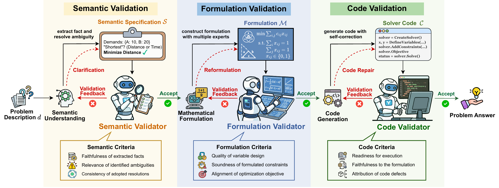

<div align="center">

# TriVAL

### A Tri-Validation Framework for Faithful Automatic Optimization Modeling

Ziyang Fang · JinXi Wang · Jinghui Zhong · Yew-Soon Ong

[](https://arxiv.org/abs/2605.23966) [](pyproject.toml) [](LICENSE) [](benchmark/DATA_LICENSES.md#nl4cop)

[Project website](https://scut-eipi.github.io/TriVAL/) · [Quick start](#quick-start) · [NL4COP](#nl4cop) · [Citation](#citation)

</div>

TriVAL translates natural-language optimization problems into solver code. It validates the semantic specification, mathematical formulation, and implementation as they are constructed so that errors can be corrected before they propagate.

[](assets/trival_framework.png)

1. **Semantic validation** extracts the problem facts, identifies ambiguities that affect the model, and checks the adopted interpretations against the problem description. [Implementation and prompts](agents/nodes/semantic_validation/)
2. **Formulation validation** compares four complete models proposed by experts with different modeling perspectives. A validator examines the selected model’s variables, constraints, and objective. Feedback can trigger a local correction or a new round of formulation. [Implementation and prompts](agents/nodes/formulation_validation/)
3. **Code validation** compares the generated program and its execution feedback with the selected formulation. A translation error goes back to the code agent. A modeling error goes back to the formulation stage. [Implementation and prompts](agents/nodes/code_validation/)

## Quick start

Install with [uv](https://docs.astral.sh/uv/) and Python 3.13. Building ECOS from source requires a C compiler.

```bash
git clone https://github.com/SCUT-EIPI/TriVAL.git
cd TriVAL
uv sync --locked --python 3.13
cp .env.example .env
```

Set `DEEPSEEK_API_KEY` in `.env`, then run the workshop example:

```bash
uv run python run.py --file examples/problem.txt
```

For a benchmark instance, select the dataset and index:

```bash
uv run python run.py --dataset nl4cop --index 3
```

## NL4COP

NL4COP contains **150 natural-language problems across 50 combinatorial optimization problem types**, with a simple, medium, and hard instance of each type. Every instance includes a reference solution and solver code. [Browse the instances](benchmark/NL4COP/) · [Benchmark datasets](benchmark/README.md)

## Citation

If you use TriVAL or NL4COP, please cite:

```bibtex
@article{fang2026trival,
  title = {TriVAL: A Tri-Validation Framework for Faithful Automatic Optimization Modeling},
  author = {Fang, Ziyang and Wang, JinXi and Zhong, Jinghui and Ong, Yew-Soon},
  journal = {arXiv preprint arXiv:2605.23966},
  year = {2026},
  doi = {10.48550/arXiv.2605.23966}
}
```

## License

The implementation is released under the [MIT License](LICENSE) and NL4COP under [CC BY 4.0](benchmark/licenses/CC-BY-4.0.txt). See [dataset licenses and attribution](benchmark/DATA_LICENSES.md) for third-party benchmarks.
