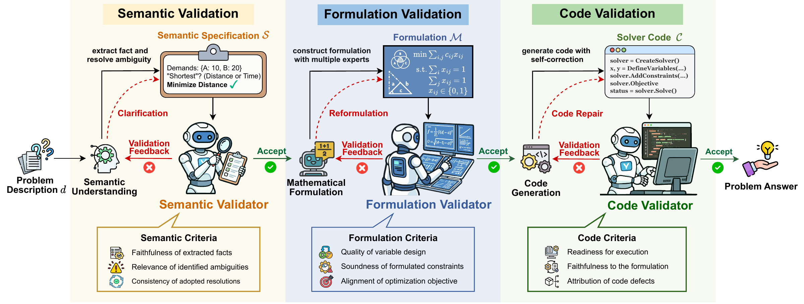

<div align="center">

# TriVAL

### A Tri-Validation Framework for Faithful Automatic Optimization Modeling

Ziyang Fang · JinXi Wang · Jinghui Zhong · Yew-Soon Ong

[](https://arxiv.org/abs/2605.23966) [](pyproject.toml) [](LICENSE) [](benchmark/DATA_LICENSES.md#nl4cop)

[Overview](#overview) · [Quick start](#quick-start) · [NL4COP](#nl4cop) · [Citation](#citation)

</div>

Official implementation of **TriVAL**. The repository provides the method and prompts, the **NL4COP benchmark**, prepared third-party benchmark data, and a runner for one problem.

## Overview

TriVAL turns natural-language optimization problems into solver code through a **construct-validate-revise** loop at three stages:

- **Semantic Validation** checks extracted facts, identified ambiguities, and adopted resolutions.
- **Formulation Validation** selects and checks a complete formulation from four expert candidates.
- **Code Validation** checks execution and implementation fidelity, and routes defects to code repair or formulation revision.

[](assets/trival_framework.png)

Read the [paper](https://arxiv.org/abs/2605.23966) for the full method and experiments. Implementation terms are defined in the [glossary](GLOSSARY.md).

## Quick start

Use **Python 3.13**, [uv](https://docs.astral.sh/uv/), and a DeepSeek API key. Solver dependencies, including OR-Tools and CVXPY, are pinned in `uv.lock`.

A C compiler is required to build ECOS on Python 3.13.

### 1. Install

```bash
git clone https://github.com/SCUT-EIPI/TriVAL.git
cd TriVAL
uv sync --locked --python 3.13
cp .env.example .env
```

### 2. Configure the API key

Set the key in your local `.env` file:

```dotenv
DEEPSEEK_API_KEY=your_deepseek_api_key
```

The runtime uses the official DeepSeek API with **`deepseek-flash`** and thinking mode disabled. Use `--model` to select another supported model; see the [DeepSeek documentation](https://api-docs.deepseek.com/quick_start/pricing/) for current identifiers.

### 3. Run one problem

Run NL4COP's `assignment_problem_001`, whose reference minimum total cost is **145**:

```bash
uv run python run.py --dataset nl4cop --index 3
```

`--index` is a zero-based record position. NL4COP records are sorted by `problem_id`. Only the problem description is sent to TriVAL; reference answers and solver code are not sent to the model.

To use your own problem, provide a UTF-8 text file containing the description and all instance data:

```bash
uv run python run.py --file examples/problem.txt
```

The bundled workshop example has an optimal solution of **4 tables and 14 chairs**, with profit **480**.

The runner prints generated code and execution feedback. Exit status `0` means execution succeeded and code validation passed. Generated code runs locally; use an isolated environment.

For all command options:

```bash
uv run python run.py --help
```

## NL4COP

**NL4COP** covers combinatorial optimization problems with complex decision logic and interacting constraints, including routing, scheduling, packing, and graph optimization.

| Instances | Problem types | Difficulty levels |
| :---: | :---: | :---: |
| **150** | **50** | `simple` · `medium` · `hard` |

Each problem type has one instance at each difficulty. Records include the problem description, a reference solution, and reference Python solver code.

[Browse NL4COP](benchmark/NL4COP/) · [Data format and benchmark counts](benchmark/README.md) · [Sources and licenses](benchmark/DATA_LICENSES.md)

<details>
<summary>Code map and offline checks</summary>

| Path | Contents |
| --- | --- |
| [`agents/`](agents/) | Workflow, state, schemas, and DeepSeek client |
| [`agents/nodes/semantic_validation/`](agents/nodes/semantic_validation/) | Semantic fact extractor, ambiguity resolver, validator, and prompts |
| [`agents/nodes/formulation_validation/`](agents/nodes/formulation_validation/) | Four experts, selector, validator, revision, and prompts |
| [`agents/nodes/code_validation/`](agents/nodes/code_validation/) | Code agent, tools, executor, validator, and prompts |
| [`experiments/manager/`](experiments/manager/) | Dataset readers |
| [`run.py`](run.py) | Single-problem command |
| [`tests/`](tests/) | Offline checks for the runner, workflow, and revision paths |

Run the offline checks without calling a live API:

```bash
uv run python -m unittest discover -s tests -v
```

</details>

## Citation

If you use TriVAL or NL4COP, please cite:

```bibtex
@article{fang2026trival,
  title = {TriVAL: A Tri-Validation Framework for Faithful Automatic Optimization Modeling},
  author = {Fang, Ziyang and Wang, JinXi and Zhong, Jinghui and Ong, Yew-Soon},
  journal = {arXiv preprint arXiv:2605.23966},
  year = {2026},
  doi = {10.48550/arXiv.2605.23966}
}
```

Please also cite the original work when using a [third-party benchmark](benchmark/DATA_LICENSES.md).

## License

**Code:** [MIT](LICENSE). **NL4COP data:** [CC BY 4.0](benchmark/licenses/CC-BY-4.0.txt), including reference solutions and embedded solver code. Third-party data retains its [original terms](benchmark/DATA_LICENSES.md). ComplexOR is not redistributed; see its [upstream repository](https://github.com/xzymustbexzy/Chain-of-Experts).

Questions and bug reports: [GitHub Issues](https://github.com/SCUT-EIPI/TriVAL/issues).
